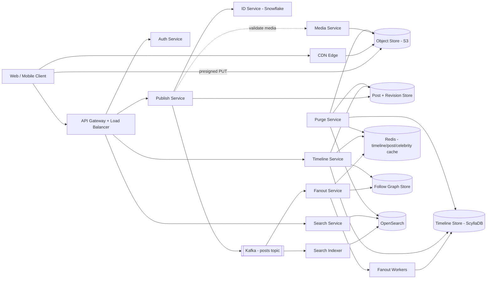

# Problem 1 deliverable: Chirp

All sections completed. Numbers are those given in PROMPT.md; every assumed figure is stated where it is used and summarised in section 1. Arithmetic is shown, not asserted.


---

## 1. Use cases and scope

Use cases, in priority order. The ordering is load-driven, not feature-driven: the top two are
where the traffic is and where I spend the engineering effort.

1. **Read the home timeline.** The dominant read. Optimised hardest (section 7).
2. **Publish a post**, with or without one image. The dominant write and the root of fanout.
3. **Search the public corpus.** Freshness-critical (5 s), read-heavy.
4. **Edit a post inside the 15 minute window**, and read the edit history.
5. **Follow / unfollow an account.**
6. **Delete an account**, and purge its posts from every timeline within 24 hours.

Deliberately excluded, per the prompt: direct messages, notifications, trending topics,
advertising, recommendation ranking, and the follow graph's own storage design beyond what the
timeline needs. Moderation is out of scope as a policy; I note only where the hook belongs — an
asynchronous scan stage on the publish path between ingest and fanout (section 4, Media and Publish
Ingest), so that a moderation verdict can suppress fanout without changing the API.

---


### Assumptions the prompt did not settle

Every figure below is mine. Each is used in section 2 with its working shown.

| Assumption | Value I chose | Why |
|------------|---------------|-----|
| Peak-to-average multiplier | 3x | Social traffic has a strong diurnal peak and event spikes; 3x is the working headroom, and section 7 says what absorbs it. |
| Share of posts carrying an image | 15% | Microblog image rates run roughly 10–25%; 15% is mid-range and conservative on egress. |
| Avg original image size | 1.5 MB | The cap is 2 MB; most camera uploads land under it. Using the cap would over-state media by ~33%. |
| Rendered renditions | 3 (thumb 30 KB, medium 150 KB, full 600 KB) + original | A feed needs thumb/medium; the original is the edit/retrieval master. |
| Avg post body length | 400 characters (~400 bytes) | The cap is 500; most posts are shorter. Used for body storage, not for the cap. |
| Avg followees per active user | 200 | Needed to size the read-time merge for pulled (celebrity) posts. |
| Timeline retention | Last 800 entries per user | Bounds materialised-timeline storage to a steady state rather than a monthly growth line (section 2). |
| Edit incidence | 5% of posts, avg 1.5 stored revisions each | Drives (negligible) edit-history storage. |
| Account deletions | 100,000 per month (~3,300/day) | 0.5% of accounts per month; drives purge throughput, not steady state. |
| Search queries | 0.5 per user per day | Small relative to timeline reads. |
| Read-to-write ratio | See section 2 | Stated explicitly, dual-framed, cross-checked. |
| Fanout / pull threshold | 10,000 followers | The push/pull boundary; justified in decision record 1. |


---

## 2. Capacity estimation

### 2.1 Write rate

```
average posts/s = 50,000,000 / 86,400 = 578.7 ≈ 579 posts/s
peak posts/s    = 579 × 3 (peak multiplier, section 1) = 1,737 posts/s
```

### 2.2 Fanout writes at the average fanout

```
average fanout writes/s = 579 × 50                    = 28,935 ≈ 29k writes/s
peak fanout writes/s    = 1,737 × 50                  = 86,850 ≈ 87k writes/s
daily fanout writes     = 50,000,000 × 50             = 2.5B writes/day
```

29k writes/s average is well inside a single wide-column cluster. **The average is not the
problem.**

### 2.3 The skew case (this is the problem)

```
accounts in the top 0.1%        = 20,000,000 × 0.001         = 20,000 accounts
minimum follower edges from them = 20,000 × 1,000,000        = 2.0 × 10^10 = 20 billion edges
cost of ONE post from such account =                 >= 1,000,000 timeline writes, in one burst
```

At one post per day per celebrity:

```
celebrity fanout writes/day = 20,000 × 1,000,000 = 20B/day
celebrity fanout writes/s   = 20,000,000,000 / 86,400 ≈ 231,481 writes/s
```

At the pack's implied per-user posting rate (`50,000,000 / 20,000,000 = 2.5 posts/user/day`):

```
celebrity fanout writes/s = 20,000 × 2.5 × 1,000,000 / 86,400 ≈ 578,704 writes/s
```

That is **8x to 20x** the average fanout path, produced by **0.04% of posts**. A write-time push
for these accounts is a self-inflicted denial of service: one celebrity post spawns >1M writes
against 87k/s of provisioned headroom and starves every other producer. This single result forces
the hybrid fanout in decision record 1.

### 2.4 Constraint tension: "average fanout 50" cannot be an arithmetic mean

The two figures do not reconcile. Proof by the average itself:

```
fanout writes implied by the average = 50,000,000 posts/day × 50 = 2.5B writes/day
fanout writes implied by the floor   = 20,000 celebs  × 1M followers, >= 20B writes/day
```

The celebrity **floor alone** is at least `20B / 2.5B = 8x` the total the average permits. If `50`
were the arithmetic mean over posts, the celebrity population could not exist. Therefore:

> **Reading I adopt:** `50` is the **median (typical) fanout of the bulk corpus**. The top 0.1% is a
> distinct, heavier-tailed regime, not an input to that mean. This is the only reading under which
> both figures hold, and it is the reading the hybrid design is built on.

A corollary worth naming: `50M posts / 20M users = 2.5 posts/user/day` is high for a microblog, so
the write side is unusually hot relative to a typical feed product; it reinforces caching the read
path hard rather than assuming a lower write rate.

### 2.5 Storage per month

Treating each store separately. Redundancy is stated but not folded into the "logical" figures.

**Post bodies.** Assumed average body 400 B (section 1):

```
50M posts/day × 400 B = 20 GB/day → ×30 = 600 GB/month logical
with replication factor 3                      ≈ 1.8 TB/month on disk
```

**Images.** 15% of posts, avg original 1.5 MB, plus three renditions:

```
images/day          = 50M × 0.15 = 7.5M images/day
originals/day       = 7.5M × 1.5 MB   = 11.25 TB/day
renditions/day      = 7.5M × (30KB+150KB+600KB) = 7.5M × 780KB = 5.85 TB/day
media total/day     = 11.25 + 5.85 = 17.1 TB/day → ×30 ≈ 513 TB/month logical
with erasure/object-store redundancy (~1.5x)    ≈ 770 TB/month
```

Media dominates storage by roughly three orders of magnitude over text. This is why media lives in
object storage with a lifecycle policy, never in the primary datastore.

**Edit history.** 5% edited, 1.5 stored revisions each:

```
edited posts/day = 50M × 0.05 = 2.5M
revision bytes   = 2.5M × 1.5 × 400 B = 1.5 GB/day → ×30 ≈ 45 GB/month
```

Negligible. It is why revision history can be stored as **full snapshots** rather than deltas
(decision record 2), avoiding delta-chain reconstruction complexity for no meaningful saving.

**Materialised timelines.** Entry logical size ~64 B (`post_id` 8 + `author_id` 8 + `created_at` 8 +
row/key overhead ~40). Bounded by retention, so this is a steady state, not a monthly line:

```
ingress if all fanout were pushed = 2.5B entries/day × 64 B = 160 GB/day
steady state = 20M users × 800 retained entries × 64 B = 16B entries × 64 B ≈ 1.0 TB
with replication factor 3 ≈ 3.1 TB on disk (steady state)
```

The hybrid removes the celebrity share of the 2.5B/day from this path entirely, so real ingress is
below 160 GB/day. Retention, not traffic, sets the ceiling.

**Search index.** ~1 KB per document (body + metadata + inverted terms):

```
50M docs/day × 1 KB = 50 GB/day → ×30 = 1.5 TB/month logical
with 2 replicas (3 copies)           ≈ 4.5 TB/month on disk
```

### 2.6 Read-to-write ratio — stated explicitly, dual-framed

A timeline *request* hydrates a page of up to 20 posts, so **request ratio** and **content ratio**
differ by roughly 20x. Both are stated because replication and cache sizing follow the request
rate, while CDN and byte egress follow the content rate.

Cross-check against per-user behaviour (20M DAU), assumed per user per day:
20 timeline page loads (the app refreshes on open and on scroll), 3 single-post reads,
0.5 searches, 1 profile view.

```
reads/day  = 20M × (20 + 3 + 0.5 + 1) = 20M × 24.5 = 490M requests/day
reads/s    = 490,000,000 / 86,400 ≈ 5,671 requests/s average
peak       = 5,671 × 3 ≈ 17,014 requests/s
request RPS ratio = 490M / 50M ≈ 9.8 : 1  → I state this as ~10:1
```

Cross-check on the other axis, content reads (post impressions):

```
timeline impressions/day = 490M requests × (20/24.5 timeline share) × 20 posts ≈ 8.0B
+ 60M single-post reads
content ratio ≈ (8.0B + 0.06B) / 50M ≈ 161 : 1  → I state this as ~160–200:1
sanity: 8.06B impressions / 20M users = 403 impressions/user/day
        ≈ one post every 2.4 minutes over a 16h day — plausible for a feed
        and 8.06B / 50M posts = each post seen ~161 times — plausible at 50 median followers
        only if followers resample; I do not rely on the exact figure, only its order of magnitude.
```

**Adopted: ~10:1 at request granularity (≈5.7k reads/s, 17k/s peak) and ~160:1 at content
granularity.** The request ratio sizes replicas and connection pools; the content ratio sizes
caches and CDN.

### 2.7 Egress bandwidth for images, and what it implies for caching

Each rendered page shows 20 posts; assumed 30% carry an image in-feed, served as the 150 KB medium
rendition:

```
images/s  = 5,671 page loads/s × 6 images = 34,026 images/s
egress   = 34,026 × 150 KB ≈ 5.1 GB/s ≈ 440 TB/day
peak     = ×3 ≈ 15.3 GB/s
```

440 TB/day from origin is not purchasable at any sane price. **This forces a CDN**: at a 95% edge
hit ratio the origin sees ~0.26 GB/s average (0.77 GB/s peak), which is serviceable. The cache
policy that produces that hit ratio is in decision record 5 (content-addressed keys, immutable
renditions, long edge TTLs, only originals made mutable).


## 3. High-level design and diagram

One diagram, in a Mermaid fenced code block, showing components and the direction of data flow.
Then prose that walks the write path and the read path.

The diagram and the prose must agree. So must the diagram and section 4.

## 3. High-level design and diagram



### Write path

1. Client requests a presigned URL from **Media Service** if the post carries an image, and `PUT`s
   the bytes directly to **S3**. The API tier never proxies image bytes.
2. Client calls `POST /posts` through the **API Gateway**, which authenticates at the edge and
   forwards to **Publish Service**.
3. Publish Service allocates a Snowflake `post_id` from **ID Service**, writes the post row and
   `revision 1` to **Post + Revision Store**, and records the idempotency key. This is the only
   synchronous durable write on the publish path.
4. Publish Service appends one `post.created` event to the Kafka **posts topic** and returns `201`
   with the `Post`. The event, not the response, is what drives fanout and indexing.
5. **Fanout Service** consumes the topic. It reads the author's follower count from **Follow Graph
   Store**:
   - **ordinary author (≤ 10,000 followers):** it expands the post to follower ids and hands
     batched inserts to **Fanout Workers**, which append `(viewer_id, created_at, post_id,
     author_id)` rows to the **Timeline Store** and refresh the corresponding **Redis** timeline
     caches.
   - **celebrity author (> 10,000 followers):** it does **no** per-follower write. It appends the
     post to the author's **celebrity list** in Redis and in the Timeline Store under an author key.
     Followers merge these at read time.
6. **Search Indexer** consumes the same topic and upserts the document into **OpenSearch**. One
   topic, two independent consumers, both idempotent.

### Read path (home timeline)

1. Client calls `GET /timelines/home` via the Gateway → **Timeline Service**.
2. Timeline Service fetches the viewer's materialised entries: **Redis** on hit, **Timeline Store**
   on miss (which also repopulates the cache).
3. It fetches the viewer's **pull list** — the celebrities this viewer follows — from a cached
   per-viewer follow-graph projection.
4. It merges the pushed entries with the celebrities' recent posts, both keyed by
   `(created_at, post_id)` and bounded by the requested cursor, to a single ordered page.
5. It hydrates the `post_id`s to `Post` objects with a batched multiget against the **Redis** post
   cache, falling through to **Post + Revision Store**. Tombstoned/deleted ids are dropped here.
6. It returns `{ items, next_cursor }` matching section 5.

The edit and delete paths and the purge are described in decision records 2 and 4 and traced in
section 12.

